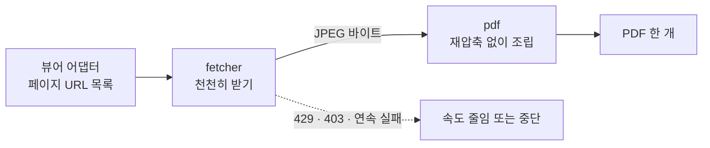

# Ebook → PDF

열람 권한이 있는 이미지형 웹 전자책을, 브라우저 안에서 PDF 한 개로 합쳐 저장합니다.


> [!IMPORTANT]
> 아직 설치해서 쓸 수 있는 확장 프로그램이 아닙니다. 현재는 PDF 조립과 페이지 수집을 맡는 코어 모듈(`src/core`)만 구현되어 있습니다.

## 상태

| 단계 | 내용 | 상태 |
|---|---|---|
| 1 | 코어: PDF 조립(`pdf.js`), 페이지 수집(`fetcher.js`), 테스트 | 완료 |
| 2 | 뷰어 어댑터, content script, 진행률 패널, `manifest.json` | 예정 |
| 3 | 실제 뷰어에서 확인, 크롬 확장으로 배포 준비 | 예정 |

## 특징

- **재압축 없음**: 원본 JPEG 바이트를 그대로 PDF에 넣습니다. 화질 손실과 불필요한 CPU 사용이 없습니다.
- **천천히 받기**: 기본 동시 요청 2장에 요청 사이 간격을 둡니다. 서버에 부담을 주지 않는 것이 기본값입니다.
- **429·403에 반응**: 동시 수를 줄이고 `Retry-After`를 따라 쉽니다. 계속 실패하면 중단하고 실패한 페이지 번호를 알려 줍니다.
- **취소와 이어받기**: `AbortSignal`로 중단할 수 있고, 이미 받은 페이지는 다시 받지 않습니다.
- **의존성 없음**: 바닐라 JS(ES 모듈)만 씁니다. 빌드 단계가 없습니다.
- **브라우저 안에서만 처리**: 외부 서버 전송, 분석, 텔레메트리 코드가 없습니다.

## 동작 방식



1. 사용자가 이미 열어 둔 뷰어 탭에서 버튼을 누르면 시작합니다. 백그라운드에서 자동으로 수집하지 않습니다.
2. 어댑터가 페이지 이미지 URL 목록을 만듭니다. (2단계에서 구현)
3. `fetchPages`가 로그인된 탭의 정상 요청으로 이미지를 순서대로 받습니다.
4. `buildPdf`가 JPEG의 크기와 채널 수를 읽어, 페이지마다 이미지 한 장씩 담은 PDF를 만듭니다.

## 코어 모듈 사용법

Node.js 18 이상 또는 최신 브라우저에서 동작합니다.

```js
import { fetchPages } from './src/core/fetcher.js';
import { buildPdf, readJpegInfo } from './src/core/pdf.js';

const cache = new Map();           // 같은 cache로 다시 호출하면 이어받습니다
const ctrl = new AbortController();

const { results, failed, stopped } = await fetchPages(urls, {
  cache,
  signal: ctrl.signal,
  onProgress: ({ done, total, bytes }) => console.log(done, '/', total, bytes),
});

if (failed.length) {
  console.error('받지 못한 페이지:', failed, stopped);   // 1부터 센 번호
} else {
  const pdf = buildPdf(results.map(bytes => ({ bytes, ...readJpegInfo(bytes) })));
  // pdf는 Blob입니다
}
```

### `fetchPages(urls, options)` 옵션

| 옵션 | 기본값 | 설명 |
|---|---|---|
| `concurrency` | `2` | 동시 요청 수 |
| `intervalMs` | `400` | 요청 시작 사이 최소 간격(ms) |
| `maxRetries` | `3` | 페이지당 재시도 횟수. 대기는 `backoffMs`부터 2배씩 늘어납니다 |
| `backoffMs` | `1000` | 재시도 대기 기준(ms) |
| `maxConsecutiveFailures` | `3` | 이 수만큼 연속으로 실패하면 중단 |
| `signal` | - | `AbortSignal`. 취소하면 `signal.reason`으로 reject |
| `cache` | 새 `Map` | 이미 받은 페이지(0부터). 이어받기용 |
| `onProgress` | - | `{ done, total, bytes }` 콜백 |
| `fetch` | 전역 `fetch` | 교체 가능(테스트, 다른 출처 처리용) |

응답별 처리는 다음과 같습니다.

| 응답 | 동작 |
|---|---|
| 429, 403 | 동시 수를 1 줄이고(최소 1), `Retry-After`(초 또는 날짜)가 있으면 그만큼, 없으면 백오프만큼 전체가 쉼 |
| 408, 5xx, 네트워크 오류 | 백오프 후 재시도 |
| 그 밖의 4xx(404 등) | 재시도하지 않고 실패 처리 |

### `buildPdf(images)`

`{ bytes, width, height, components }` 배열을 받아 `Blob`을 돌려줍니다. 1채널(흑백)과 3채널(컬러) JPEG만 지원하며, 그 밖의 채널 수는 에러입니다. `readJpegInfo(bytes)`로 크기와 채널 수를 읽을 수 있습니다.

## 안전과 한계

- **접근 제한을 우회하지 않습니다.** DRM 해제, 로그인·CAPTCHA 우회, 서명 URL 위조 기능은 없고 앞으로도 추가하지 않습니다. 이미 열린 탭이 정상적으로 보내는 요청만 사용합니다.
- **사용자가 누를 때만 동작합니다.** 백그라운드 수집, 예약 실행은 만들지 않습니다.
- **데이터가 밖으로 나가지 않습니다.** 받은 이미지와 PDF는 브라우저 안에서만 다룹니다.

지원하지 않는 것:

- JPEG가 아닌 이미지, CMYK(4채널) JPEG
- 텍스트 레이어와 목차(OCR 포함). 결과 PDF는 페이지 이미지만 담습니다.
- 서버가 접근을 막은 경우의 우회. 이때는 중단하고 알립니다.

## 개발

외부 의존성이 없습니다.

```
npm test
node scripts/verify-pdf.mjs <결과.pdf> [원본이미지폴더]
```

- `tests/`는 `node --test`로 실행하며, 가짜 JPEG와 가짜 `fetch`·시계를 씁니다. 실제 전자책 이미지는 저장소에 넣지 않습니다.
- `scripts/verify-pdf.mjs`는 PDF의 헤더, xref 오프셋, 페이지 순서, JPEG 시작·끝 표시를 검사하고, 원본 폴더를 주면 바이트 단위로 비교합니다.

```
src/core/pdf.js        이미지 배열 -> PDF Blob
src/core/fetcher.js    동시성, 재시도, 백오프, 취소, 이어받기
tests/                 node --test
scripts/verify-pdf.mjs 생성한 PDF 검증
```

## 용도와 책임

이 도구는 **사용자가 이미 열람 권한을 가진 전자책을 개인 보관용 PDF로 저장**하기 위한 것입니다.

내려받은 자료의 저작권은 원저작자와 서비스 제공자에게 있습니다. 저장한 PDF를 재배포, 공유, 판매하는 것은 이 도구의 용도가 아니며, 해당 서비스의 이용약관과 저작권법을 지킬 책임은 사용자에게 있습니다. 이 도구의 작성자는 오용에 대한 책임을 지지 않습니다.

## 라이선스

[MIT](LICENSE)
